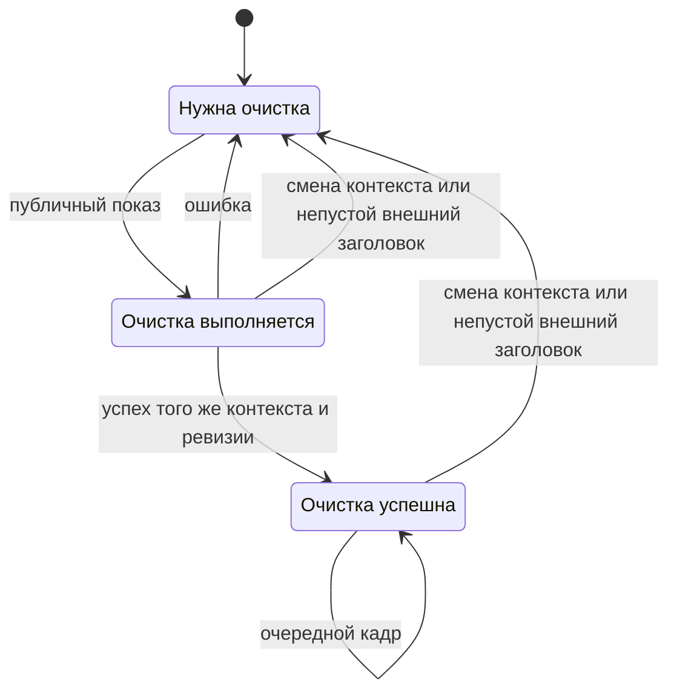
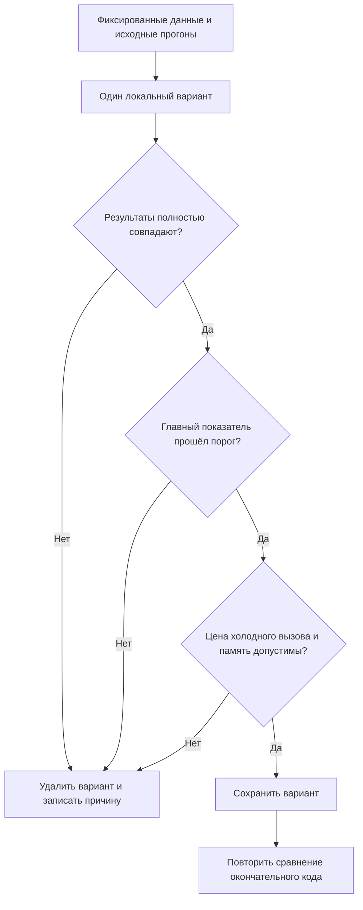

# Локальные исправления по аудиту производительности - Plan

## Goal Capsule

- **Цель:** уменьшить доказанные локальные затраты плагина и ожидание его пересборки для пользователя и разработчика.
- **Способ:** выполнить ограниченные изменения существующих механизмов по KTD1–KTD6 и сохранить только варианты с подтверждённым результатом.
- **Источники полномочий:** поручение владельца, `AGENTS.md`, `CONTRIBUTING.md`, `TESTING.md`, `docs/maintenance/performance/README.md`; исходные наблюдения — `docs/maintenance/performance/audits/2026-10-13-full-audit.md` и `docs/maintenance/performance/journal.md`.
- **Режим:** локальная последовательная реализация в текущей `main`; завершение, общие проверки, независимую проверку изменений и коммит выполняет основная сессия.
- **Остановка зависимой работы:** нарушение R1–R3, необходимость решения владельца из границ объёма или исчерпание бюджета измерений. Независимые разрешённые проверки продолжаются. Неудачный эксперимент завершается удалением его изменений и записью причины.

---

## Product Contract

### Summary

Сократить повторный разбор метаданных установки Mac, лишние команды заголовка и повторную генерацию иконок.
Проверить ограничение одновременного чтения хвостов Codex и, при оставшемся бюджете, разбор дат неактивных задач T3.
Повторно сравнить три уже выполненные локальные правки на окончательном коде.

### Problem Frame

Аудит от 13 октября обнаружил повторную работу во время наблюдения и сборки, а также большие временные выделения памяти при первом чтении истории.
В локальной модели обнаружение Mac выполняло 125 системных команд за 347,5 мс, а генератор неизменных иконок занимал 43,6 мс из 105,1 мс сборочной части разработки.
На шести анимированных кнопках 120 кадров отправляли 720 изображений и 720 одинаковых очисток заголовка.
Эти числа показывают конкретные причины затрат, но не доказывают задержку установленного плагина или физического устройства.

### Requirements

**Сохранность и полномочия**

- R1. Сохранить поддержанные возможности и границы из `README.md`, `docs/ARCHITECTURE.md` и `SECURITY.md`, включая самостоятельный Windows, независимые источники, проверку личности, loopback, свежесть, отмену и защитные пределы.
- R2. Работать в текущей `main`, сохранить изменения этой задачи и не менять посторонние файлы; новые ветки, установка, перезапуск живых приложений, удалённые записи и платные запуски не входят в поручение.
- R3. Сохранить обязательные проверки и защитные ожидания без ослабления; не менять условия измерителя ради прохождения порога.

**Наблюдение, отображение и сборка**

- R4. Повторное обнаружение Mac должно меньше разбирать неизменные метаданные, сохраняя обнаружение новых установок, выбор работающего экземпляра и проверку текущих файлов.
- R5. Повторные кадры должны подавлять успешную и ещё выполняющуюся одинаковую очистку заголовка одного контекста действия, сохраняя повтор после ошибки и новую очистку после смены контекста.
- R6. Сборка должна пропускать генерацию неизменных иконок только при подтверждённых входах и целых выходах, сохраняя точные байты PNG.
- R7. Ограничение чтений Codex допустимо только при выигрышe памяти и сохранении полного результата, порядка, свежести и допустимого времени первого прохода.
- R8. Разбор дат T3 можно сократить для невыводимых задач без изменения возвращаемых полей и правил состояний.

**Доказательства и завершение**

- R9. Каждая сохранённая правка, включая три прежние, должна иметь сравнение исходного и окончательного кода по `docs/maintenance/performance/README.md`; отменённые попытки и осознанно пропущенные направления записываются в журнал.
- R10. Завершить работу полными автоматическими проверками из `CONTRIBUTING.md`, устранёнными существенными замечаниями проверки изменений и локальным коммитом; автоматическую, прикладную и физическую проверку сообщать отдельно.

### Scope Boundaries

В объём входят U1–U5 и условная U6. Они меняют внутреннюю обработку существующих данных и команд, не добавляют возможности продукта.

**Решения владельца, отложенные за пределы этой работы:** происхождение и выбор обложки PNG/JPEG; минификация и доставка карты исходников; срок хранения подтверждений завершения; индекс истории с файловыми событиями; независимая публикация источников SSH; постоянный канал T3; приоритеты вместимости подключений.

**Рассмотрено и не выполняется:** подавление одинаковых записей состояния наблюдателя Mac. Цена записи пока не измерена, а безопасная правка требует проверки сохранения состояния до восстановления. Это направление возобновляется при измеренном существенном вкладе записи; причина текущего отказа попадает в журнал по R9.

Кэш изображения по параметрам и повторное преобразование OpenCode не входят в активные изменения: аудит показал малую абсолютную цену и много условий корректности. Сокращение периодов опроса и таймаутов запрещено R3.

### Sources

- `docs/maintenance/performance/audits/2026-10-13-full-audit.md`: условия, счётчики, приоритеты и ограничения исходного аудита.
- `docs/maintenance/performance/audits/2026-10-13.md`: исследование и сравнение прежних трёх правок.
- `docs/maintenance/performance/journal.md`: принятые варианты, цена холодного прохода и известные пробелы проверки.
- `PRODUCT.md`: локальное отображение задач на физических клавишах, границы платформ и источников; документ лендинга не задаёт новые возможности плагина.

---

## Planning Contract

### Key Technical Decisions

- KTD1. **Прежние три правки проверяются в окончательной композиции.** Сравнивать исходную Git-базу с окончательными владельцем файлов Codex, сборщиком OpenCode и очередью; не переизобретать изменения. Если сохраняется U5, эффект кэша Codex сравнивается при одинаковом окончательном пределе чтений, а эффект предела — при одинаковом кэше. Три временные версии измерения: без кэша с окончательным пределом; кэш без предела; окончательный кэш с пределом. Вариант исходной базы с пределом нужен только вне репозитория для сравнения, производственный код не получает режимов измерителя. База и прежние сценарии указаны в журнале; выполняется R9.
- KTD2. **Кэшировать разбор метаданных, сохранив свежий поиск кандидатов.** Обрабатывать весь существующий набор кандидатов, а результаты разбора повторно использовать по подписи текущего `Info.plist`. Подпись учитывает идентичность файла, размер, время содержимого и метаданных; полностью прочитанные поля принимаются только при совпадении подписи до и после чтения. Проверенный чужой идентификатор также допускает повторное использование, временная ошибка — нет. Исполняемый файл проверяется заново. Оба получения процессов сохраняются: второе после обработки кандидатов даёт свежий приоритет работающей установки. Это выполняет R4 без нового индекса или службы.
- KTD3. **Состояние очистки принадлежит контексту действия.** Разделить успешный результат и выполняющееся обещание очистки от состояния картинки. После ошибки следующий публичный показ повторяет очистку даже при прежней картинке. Смена регистрации или исчезновение инвалидирует очистку; завершение старого обещания не должно пометить новый контекст успешным. Существующее `onTitleParametersDidChange` инвалидирует очистку при непустом заголовке; собственный пустой заголовок не создаёт цикл. Событие во время отправки учитывается ревизией контекста, включая отдельный путь `unregisterHostToggle`. Это выполняет R5.
- KTD4. **Использовать восстанавливаемую локальную отметку генератора.** Текущие входы — код `scripts/generate-plugin-icons.mjs` и среда Node/zlib: генератор использует только встроенные модули и не читает ассеты. Если при реализации реально выделяется вспомогательный модуль, его код входит в подпись и проверку изменения входа. Отметка содержит эту подпись и хэши обоих выходов. Отсутствие, повреждение, несовпадение входов или выходов ведёт к обычной генерации. Неполная запись не считается успехом; отметка игнорируется Git и исключается из поставки. Ошибка вспомогательной отметки не ломает сборку корректных PNG, ошибка обязательного PNG остаётся ошибкой сборки. Место отметки не провоцирует цикл наблюдения и переживает обычную очистку выходного каталога. Это выполняет R6.
- KTD5. **Менять только параллелизм чтения хвостов.** Малый локальный предел относится к чтению и разбору, а не к количеству выбранных файлов, проверке метаданных или семантике 128 последних и дополнительных отслеживаемых сессий. Результаты размещаются в исходном порядке. Выбор точного предела остаётся экспериментом по R7 и R9.
- KTD6. **T3 определяет выводимое состояние прежде необязательных дат.** Переносить работу с датами только после необходимых решений о состоянии; поля итоговой задачи и проверки завершения остаются прежними по R8. Чтение ответа и его объём не уменьшаются.

### Assumptions

Это рабочие допущения для измерений, не новые правила продукта.

- Бюджет — не более 30 минут собственно локальных измерительных прогонов; планирование и обычные автоматические проверки не расходуют его. До опытов резервируются 10 минут на обязательные окончательные сравнения; остальные 20 минут расходуются последовательно на U1 и опыты U2–U6. При достижении резерва новые опыты прекращаются. Если сохранённая правка не получила окончательное сравнение в пределах бюджета, она удаляется и записывается как неподтверждённая по R9.
- До каждого эксперимента фиксируются главный показатель, исходный разброс и допустимая цена первого вызова/памяти. По умолчанию материальная регрессия холодного времени — свыше большего из 10% и исходного разброса; для малых операций допускается не более 0,02 мс дополнительной цены, как в прежнем журнале очереди.
- Для U5 время первого полного прохода не должно выйти за указанный выше предел; выигрыш RSS должен превысить порог сравнения руководства. Одно уменьшение числа выполняющихся обещаний выигрыш памяти не доказывает.
- Новый постоянный кэш метаданных имеет явный малый предел, выбранный по наблюдаемому числу кандидатов, и удаляет исчезнувшие записи. Буферы и тексты хвостов не сохраняются.
- Точные предел параллелизма U5 и путь локальной отметки U4 выбираются при реализации, без новых межобластных абстракций.

### High-Level Technical Design

Состояния очистки заголовка отражают KTD3; отправка изображения живёт отдельно.

Выбор сохраняемого эксперимента одинаков для всех U-ID.

### Sequencing

U1 устанавливает сохранность и пригодность существующих сравнений. U2–U4 независимы по коду, но правки и измерения выполняются последовательно, чтобы не смешивать варианты в общем рабочем дереве.
U5 следует после фиксации состава Codex из U1. U6 выполняется последней при достаточном оставшемся бюджете.
После упрощения и проверки изменений повторно собираются окончательные варианты, обновляются сравнения по R9 и выполняется R10.

### System-Wide Impact

Сокращение числа команд SDK не доказывает ускорения USB; ограничение хвостов меняет временную память и может увеличивать время первого прохода.
Подавление генерации влияет на локальную и выпускную сборку, поэтому целостность обоих PNG и аудит всего набора обязательны.
Наблюдатель установлен копией: этот план проверяет сборку и изолированные сценарии, а установку исключает R2.

---

## Implementation Units

### U1. Проверить окончательную композицию трёх прежних правок

**Цель:** выполнить R9 для уже существующего результата, сохранив пользовательское рабочее дерево.
**Требования:** R1–R3, R9. **Зависимости:** нет.
**Файлы:** `src/codex/session-ownership.ts`, `src/opencode/collector.ts`, `src/agents/active-queue.ts`; `test/session-ownership.test.ts`, `test/opencode-collector.test.ts`, `test/active-queue.test.ts`; `docs/maintenance/performance/journal.md`.
**Подход:** применять KTD1; зафиксировать исходную и текущую версии и восстановить прежние сценарии вне репозитория. После всех правок сравнить окончательный код повторно; исправлять только обнаруженные дефекты текущей задачи. U1 также отвечает за журнал осознанно пропущенных направлений по R9: запись состояния наблюдателя, кэш изображений по параметрам и повторное преобразование OpenCode. У каждой записи есть причина отказа и условие возобновления исследования.
**Образцы:** существующие публичные `annotate`, `start`/`refresh`, `projectActiveQueue` и сценарии руководства.
**Проверяемые сценарии:**

1. Неизменные хвосты Codex сокращают чтения; дописывание, усечение, атомарная замена и удаление дают свежий равный результат, а ошибка не кэшируется.
2. Общий предок OpenCode запрашивается один раз внутри подключения и цикла; другое подключение и следующий цикл получают независимые свежие ответы.
3. Очередь сохраняет все назначения, порядок, дубли, недопустимые даты и приоритет последнего снимка хоста; пустая и рабочая очередь соблюдают прежнюю малую цену.

**Подтверждение:** новые окончательные сравнения подтверждают каждый сохранённый вариант или обосновывают его отмену; известные непроверенные границы из журнала не объявляются проверенными без результата.

### U2. Сократить повторный разбор метаданных установки Mac

**Цель:** уменьшить системные команды обнаружения по R4.
**Требования:** R1–R4, R9. **Зависимости:** U1 для сохранённой исходной точки.
**Файлы:** `launcher/macos/codex-deck-macos.ts`, `test/macos-launcher.test.ts`, при необходимости `test/macos-watcher.test.ts`; `docs/maintenance/performance/journal.md`.
**Подход:** выполнить KTD2 через существующую границу `discoverCodexInstallation`; не кэшировать весь результат обнаружения. Настоящий повторный вызывающий путь — `runWatcher` в `launcher/macos/codex-deck-macos.ts`: цикл `while (true)` обнаруживает установку в том же процессе, затем ждёт `POLL_MS = 1000`. Изолированный сценарий повторяет эту форму вызовов с подставными процессами и системными командами по образцу теста установщика, не выполняя восстановление настоящего приложения.
**Направление проверки:** сначала подтвердить свежий выбор и инвалидацию на временных установках, затем измерять.
**Проверяемые сценарии:**

1. Повторное обнаружение неизменных кандидатов выбирает ту же установку при меньшем числе `plutil`.
2. Замена `Info.plist` того же размера и времени, изменение версии или идентификатора приложения пересчитывает результат; чужая установка не проходит проверку личности.
3. Удалённый или переставший быть обычным файлом executable отклоняется на следующем обнаружении; временная ошибка метаданных не переживает восстановление. Замена plist между отдельными чтениями полей не принимается в кэш.
4. Новая установка обнаруживается; смена работающего экземпляра, PID или явного пути сохраняет исходный приоритет, включая необычное имя `.app`.
5. Кандидаты сверх предела кэша и исчезнувшие кандидаты не создают неограниченного удержания памяти.

**Подтверждение:** полный публичный вызов, первое и повторное обнаружение, счётчики дочерних команд и CPU; измеритель не запускает приложение и блокирует любые несогласованные команды/записи/сеть.

### U3. Подавить одинаковые очистки заголовка кнопки

**Цель:** убрать повторные команды `setTitle("")` по R5.
**Требования:** R1, R3, R5, R9. **Зависимости:** U1.
**Файлы:** `src/stream-deck/controller.ts`, `test/controller.test.ts`, при необходимости реальный обработчик `src/plugin.ts` или `src/stream-deck/actions.ts`; `docs/maintenance/performance/journal.md`.
**Подход:** применить KTD3 на публичных регистрациях и событиях действий. Обработчик подключается к настоящему жизненному циклу контроллера либо существующему пути `src/plugin.ts`, а тест вызывает зарегистрированное событие SDK. Подписка снимается при остановке. Публичные методы ради доступа к приватному кэшу не добавляются. Локальные типы и маршрутизация SDK `3.0.1` подтверждают событие; выполнение на настоящем устройстве не доказано.
**Образцы:** заглушки источников и `KeyAction`, управляемые таймеры из `test/controller.test.ts`.
**Проверяемые сценарии:**

1. Шесть рабочих кнопок за 120 кадров сохраняют изображения и число их отправок, но каждая регистрация успешно очищает заголовок единожды.
2. Одновременные публичные показы одного контекста ожидают одну очистку; ошибка очистки вызывает повтор на следующем показе при прежнем изображении.
3. Ошибка изображения при успешной очистке не вызывает новую очистку, а следующее изображение всё ещё отправляется.
4. Исчезновение и повторная регистрация с тем же идентификатором очищают заголовок заново; поздний успех старого контекста не подавляет новую очистку.
5. Непустой внешний заголовок в поддержанном событии разрешает новую команду очистки даже при прежней картинке; событие во время отправки не теряется, собственное пустое событие не зацикливает команды. При этом пользовательский custom title сохраняет правила текущего SDK, его визуальное переопределение не обещается.

**Подтверждение:** равные картинки и действия в сценариях очереди и обычной раскладки; детерминированное сокращение команд по R9. Задержка SDK и физического устройства остаётся непроверенной.

### U4. Пропускать генерацию целых неизменных иконок

**Цель:** сократить сборочную часть разработки по R6.
**Требования:** R2, R3, R6, R9, R10. **Зависимости:** U1.
**Файлы:** `scripts/build.mjs`, `scripts/generate-plugin-icons.mjs`, при необходимости `.gitignore`; новый `test/plugin-icons.test.ts` и типовая декларация скрипта при необходимости существующего способа импорта; `docs/maintenance/performance/journal.md`.
**Подход:** применить KTD4, сохранив самостоятельный запуск генератора. Проверять через импортируемую логику на временной копии, как требует `TESTING.md`; не менять рисунок, размеры или упаковочную политику.
**Проверяемые сценарии:**

1. Чистый запуск без отметки создаёт прежние PNG 256×256 и 512×512 с точными исходными хэшами.
2. Повторные неизменные входы и выходы пропускают вычисление и запись PNG, а полный `scripts/build.mjs` успешно копирует их в очищенный комплект.
3. Удаление, усечение или изменение одного PNG заставляет восстановить оба ожидаемых выхода.
4. Изменённый генератор, среда Node/zlib либо повреждённая отметка вызывает генерацию; ошибка записи не оставляет успешной отметки для неполных выходов. Недоступная вспомогательная отметка не ломает корректную сборку.
5. После удаления локального кэша обычная сборка и упаковка работают; отметка не попадает в пакет или автономные комплекты.

**Подтверждение:** одинаковые PNG и состав поставки, меньшее время полного `scripts/build.mjs` при повторной сборке и измеренная цена чистого запуска; выпускные артефакты проходят R10.

### U5. Проверить ограничение одновременных чтений хвостов Codex

**Цель:** проверить снижение временной памяти по R7, сохранив малую задержку первого прохода.
**Требования:** R1, R3, R7, R9. **Зависимости:** U1; исходная точка должна включать сохранённый кэш разбора.
**Файлы:** `src/codex/session-ownership.ts`, `test/session-ownership.test.ts`, `docs/maintenance/performance/journal.md`.
**Подход:** применить KTD5; сначала сравнить небольшой набор пределов на тех же файлах и выбрать только подтверждённый вариант. Не менять число выбранных файлов или распределение кэшированных статусов.
**Проверяемые сценарии:**

1. Первый проход 128 файлов около 512 КиБ возвращает тот же полный результат и порядок при ограниченном числе одновременных чтений.
2. Дополнительные отслеживаемые сессии вне последних 128, включая каталог свыше 512, обрабатываются полностью; одинаковые идентичности сохраняют исходный выбор последнего файла. Предел кэша остаётся прежним, детерминированность конкретного набора его записей не заявляется.
3. Ошибка, короткое чтение, дописывание и замена во время чтения не создают успешный неподтверждённый кэш; следующий проход восстанавливается.
4. Неизменный повторный проход сохраняет нулевое чтение хвостов и не получает существенного замедления от ограничителя.

**Подтверждение:** до опыта фиксируются предел задержки, одинаковый способ наблюдения RSS и отдельные свежие процессы для пар. Сравниваются первый/повторный проход, время, CPU, максимум RSS, удержанная память и полный результат. Если порог памяти или ограничение времени не пройдены, вариант удаляется и U5 завершается записью отрицательного результата.

### U6. При оставшемся бюджете отложить ненужные даты T3

**Цель:** проверить дешёвое уменьшение локальной обработки по R8.
**Требования:** R1, R3, R8, R9. **Зависимости:** U1–U5 завершены либо обоснованно отклонены; есть бюджет окончательной проверки.
**Файлы:** `src/t3code/source.ts`, `test/t3code-source.test.ts`, `docs/maintenance/performance/journal.md`.
**Подход:** выполнить KTD6 без изменений HTTP/SSH, размеров ответа, семантики snooze и подтверждений. Если сложность выходит за простой перенос вычислений, закончить направление причиной отказа.
**Проверяемые сценарии:**

1. 10000 записей всего — 9998 неактивных, одна рабочая и одна завершённая — возвращают полностью равные поля и порядок при меньшем числе разборов даты.
2. Working и approval сохраняют время начала; completed/failed сохраняют окно завершения, посещение, подтверждение, неверные даты и допустимое будущее время.
3. Deleted, archived, settled и snoozed сохраняют исходное исключение; неактивная запись с некорректными необязательными датами не меняет результат. Некорректные обязательные id/title/status по-прежнему ухудшают своё окружение, здоровые окружения сохраняются.

**Подтверждение:** полная публичная обработка фиксированного ответа на малой и большой нагрузке проходит R9; одно сокращение `Date.parse` без выигрыша выбранной метрики не принимается.

---

## Verification Contract

Правила сравнения и порог принятия принадлежат `docs/maintenance/performance/README.md` по R9: одинаковые автономные ESM-сборки `node24`, исходные прогоны до правки, чередование версий и равенство результата.
Пять пар — обычный режим; три допустимы только при явно исчезнувшей операции или достаточно малом разбросе, с записанным обоснованием.
Порог — большее из 10% и исходного относительного разброса; каждый результат после должен быть лучше каждого исходного по выбранному главному показателю.
Цена холодного вызова и памяти фиксируется до правки по допущениям, не после удачного результата.

Перед каждым новым опытом сохраняются хэши исходных файлов, размер/структура синтетических данных и версия среды. После упрощения и устранения замечаний сравнения выполняются на заново собранном окончательном коде всех сохранённых правок.
Сценарии и исходные результаты хранятся вне репозитория; в журнале остаются условия, числа, решение и способ повторить опыт без личных данных.

| Проверка | Применение и подтверждение |
|---|---|
| `npm ci` | Зависимости по текущему lockfile перед реализацией |
| `npm run lint` | Все изменения проходят текущие правила |
| `npm run check:boundaries` | Направления импортов и публичные `#area` соблюдены |
| `npm run check` | Проверка типов всей программы |
| `npm test` | Полный набор, включая изменённые публичные сценарии |
| `npm run validate` | Сборка и проверка комплекта Stream Deck |
| `npm run pack` | Проверка построения распространяемого пакета |
| `npm run audit:release` | После всех сборок проверены все выпускные корни |

Отдельно сообщаются автоматические результаты, живое приложение и физическое устройство. Последние два не проверяются в этом объёме; местная упаковка не доказывает исполнение Windows или Fedora.

---

## Definition of Done

- Для каждого U-ID есть принятое сравнение окончательного кода либо явный обоснованный отказ/отмена в журнале по R9; прежние три правки тоже охвачены. Осознанно пропущенные направления, порученные U1, также записаны. Неподтверждённые окончательным сравнением правки не остаются в коммите.
- В сохранённом изменении выполнены его требования и перечисленные сценарии; нет ослабленных проверок, случайно оставленного экспериментального кода или новых возможностей вне R1–R8.
- Существенные замечания независимой проверки изменений исправлены, и после их исправления актуальны сравнения и все проверки R10.
- Изменения этой задачи сохранены локальным коммитом в текущей `main` по R2; публикация не подразумевается. В состав входят сохранённые исходники и тесты, относящиеся к задаче изменения `AGENTS.md` и `docs/ARCHITECTURE.md`, документы аудита, журнал и этот план. Посторонние изменения сохраняются вне коммита.
- Временные деревья данных, сборки измерителя и кэши удалены в пределах уже разрешённой очистки; компактное доказательство сохранено для повторения. Размер и судьба `$CODEX_HOME/evidence` и `$CODEX_HOME/worktrees`, если они использовались, сообщены отдельно.
- Итог называет только измеренные улучшения и явно отделяет непроверенное поведение живых приложений, Windows, Fedora, физического Stream Deck и денежные расходы.
