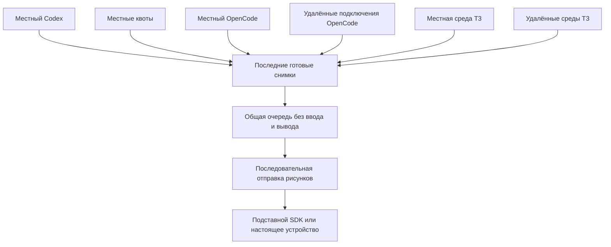
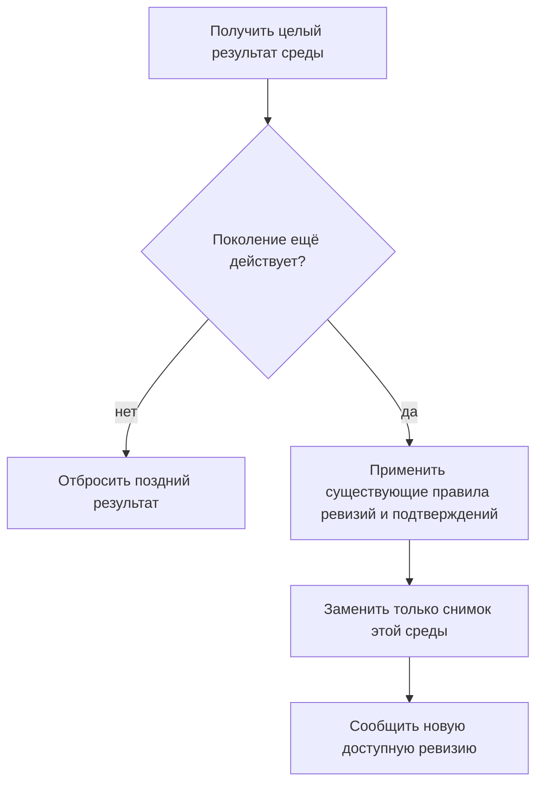
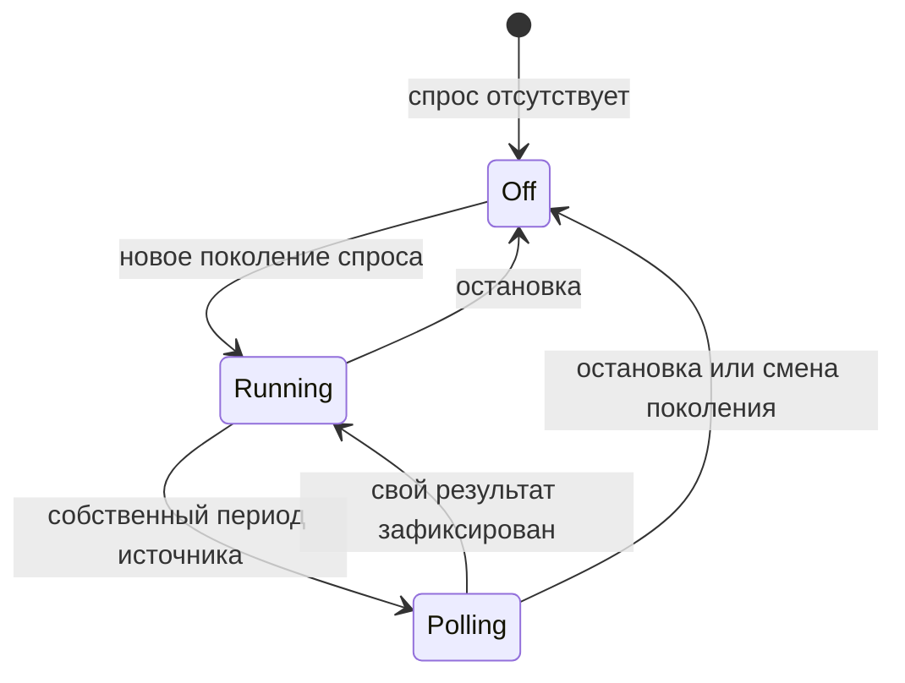
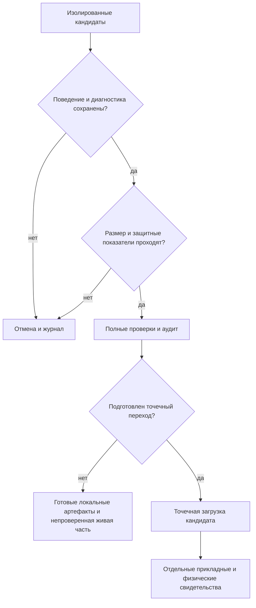
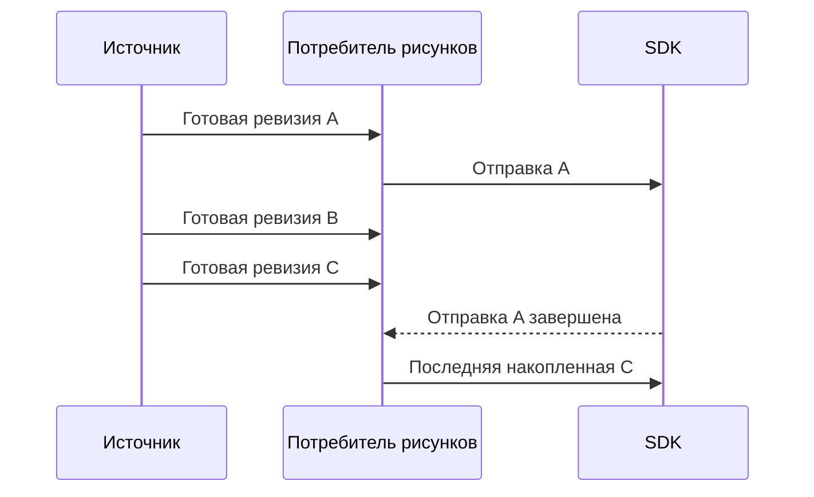
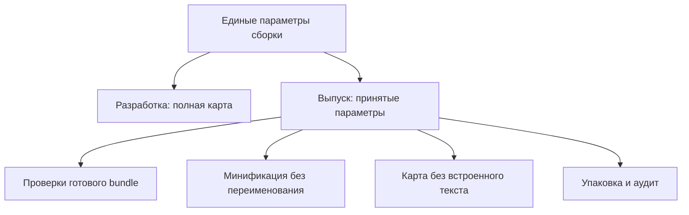

# Приёмка устройства, компактная поставка и независимые источники - Plan

## Goal Capsule

- **Цель:** Пользователь получает меньшие установочные комплекты с проверяемой диагностикой, честный результат проверки установленного плагина и готовое решение, как сохранять свежесть местных задач при медленной удалённой связи.
- **Средства:** Изолированные упаковочные варианты и раздельная приёмка по KTD1–KTD4; отдельное архитектурное предложение по KTD5–KTD7.
- **Полномочия:** Пользователь разрешил продолжение всех трёх направлений. Локальная обратимая упаковка исполняется; архитектура здесь только проектируется согласно R8. Основная сессия отвечает за принятие, исправления, итоговые проверки и сохранение непосредственно в `main`.
- **Профиль исполнения:** U1–U4 и U6 — разрешённая местная работа; U5 — документальное проектирование без изменения архитектурного кода. Ветки, отправка коммитов, публикация и выпуск не входят в работу.
- **Остановка зависимого действия:** Заменять подключённую установку только после доказанного кандидата и подготовленного точечного перехода по R2. Недоступность приложения, наблюдения устройства либо Windows блокирует только соответствующую проверку. Проигравший упаковочный вариант отменяется по R10.

---

## Product Contract

### Summary

Сократить поставку за счёт существующей авторской JPEG-обложки, консервативной минификации и карты без встроенного текста исходников.
Проверить готовый исполняемый результат, диагностические координаты и состав обоих автономных комплектов.
Отдельно получить доступные свидетельства живого приложения и физического Stream Deck, а независимость местного обновления оформить как предложение для выбора владельцем.

### Problem Frame

Шесть предыдущих исправлений проверены синтетическими сравнениями и сохранены в `main` (`c6d113b`, `81164f0`, `4e0c9f3`), но это не доказывает работу загруженной версии на устройстве.
Текущий пакет занимает 432990 байт; карта — 254094 байт его сжатых записей.
Автономные комплекты включают PNG размером 867391 байт, хотя обе README ссылаются на JPEG размером 58756 байт.
Общие ожидания в первоначальном запуске OpenCode, его сборе подключений, T3 и контроллере могут удерживать готовые местные результаты и следующий местный опрос.

### Key Decisions

- **Продолжить все три выбранных направления** (session-settled: user-directed — chosen over выполнение только одного из предложенных направлений: пользователь выбрал все варианты). Governs R1, R4, R8.
- **Архитектурное предложение отделить от применения:** выбор владельца должен предшествовать изменению границ источников. Governs R8.
- **Использовать существующую обложку после подтверждения автора:** на вопрос о происхождении пользователь ответил «Обложку делал я сам». Это заявление владельца, а не независимая юридическая проверка. Governs R4.

### Requirements

**Приёмка и полномочия**

- R1. Проверка различает автоматические результаты, работу живого приложения и физическое устройство, отдельно для предыдущей исправленной версии и окончательного упаковочного результата.
- R2. Измерительные сборки и обязательные проверки выполняются в изолированной копии, поскольку установленный плагин связан с `dist` и обычная сборка очищает его; перед точечным переходом сохранить текущий публичный bundle для возврата и доказать готовность кандидата. Разрешён перезапуск только нынешнего fork-плагина, без изменения профилей, настроек, других приложений и установленного наблюдателя.
- R3. Живые сценарии не создают задачи, не отправляют сообщения, не подтверждают модельные инструменты и не расходуют кредиты; нельзя незаметно отмечать завершённые OpenCode/T3-задачи просмотренными.

**Состав поставки и диагностика**

- R4. Оба автономных комплекта содержат существующий авторский JPEG, на который ссылаются обе README, с прежней геометрией 1280×640; различие названий на PNG/JPEG явно учитывается, исходный PNG без необходимости не удаляется.
- R5. Принимаемый вариант уменьшает измеренный размер соответствующего готового архива не менее чем на max(10%, относительный исходный разброс); размер, время запуска и скорость устройства являются разными результатами.
- R6. Принятые параметры сборки сохраняют исполнение внедряемой функции закреплённой боковой панели, UUID декораторов SDK и точную пару нажатия/отпускания.
- R7. Карта остаётся рядом с исполняемым файлом и позволяет получить исходный файл и строку искусственного исключения; полные исходники той же ревизии доступны в репозитории, полная карта разработки сохраняется.

**Архитектурное предложение и сохранение контрактов**

- R8. Дизайн описывает независимую публикацию и повторный опрос местных источников при незавершённой удалённой работе, включая все три обнаруженных барьера; применять его в рамках этого плана нельзя.
- R9. Сохраняются платформы, источники, действия, защитные периоды, лимиты и границы `AGENTS.md`, `SECURITY.md`, `docs/ARCHITECTURE.md`; для Windows не обещается равенство всех источников с Mac.
- R10. Каждый сохранённый упаковочный вариант имеет окончательное сравнение после упрощения и ревью, каждый отклонённый — отмену и запись в журнале согласно `docs/maintenance/performance/README.md`.

### Acceptance Examples

- AE1. Covers R1–R3. Устройство обнаружено, процесс работает, хэши дискового файла совпали, но экран и физический ввод не наблюдались: физическая проверка остаётся непроверенной.
- AE2. Covers R6–R7. Готовая сборка передаёт функцию в отдельный контекст исполнения, проходит закрепление/свёрнутую панель/снятие последнего закрепления и возвращает исходную строку искусственного исключения по собственной карте.
- AE3. Covers R4–R5. После распаковки обоих новых комплектов ссылки двух README находят JPEG, полный состав и реальные сжатые размеры сравниваются с исходными архивами одинакового инструмента.
- AE4. Covers R8–R9. В предлагаемом дизайне три последовательных местных изменения достигают подставного SDK до завершения удерживаемого удалённого запроса, не повышая ограничения параллелизма.

### Scope Boundaries

Постоянный SSH-канал T3, индекс истории, новые сроки хранения подтверждений и изменение допуска подключений оставлены отдельными решениями.
Не создаются новая обложка, служба диагностики, удалённое хранилище карт, публичная телеметрия, новые режимы источников и приоритеты очереди.
Полное переименование свойств, удаление диагностических сообщений и массовая замена профиля не требуются для этой работы; основанием вернуться к ним была бы отдельная подтверждённая потребность.
Прежний план `docs/plans/2026-10-14-0015-perf-local-audit-fixes-plan.md` остаётся завершённым историческим документом и не изменяется.

### Open Questions

- **Блокирует только исполнение архитектуры:** владелец выбирает предложение KTD5–KTD7, включая местный резерв и последствия первого появления карточек, либо просит другой дизайн.
- **Блокирует только Windows-проверку в живой системе:** нужна доступная самостоятельная Windows-среда и разрешённый способ работы с ней; факт уже запрошен основной сессией.
- **Блокирует только конкретную физическую приёмку:** нужен доступный способ наблюдения экрана MK.2 и реального безопасного ввода. Текущий программный интерфейс управления не нашёл окно Stream Deck.
- **Условие точечной загрузки, разрешённой живой проверкой:** кандидат проходит все изолированные проверки; текущий публичный bundle сохранён для возврата, точные файлы и способ проверки загруженной версии подготовлены. Нового общего разрешения не требуется; изменение наблюдателя или иных приложений было бы отдельным объёмом.

---

## Planning Contract

### Key Technical Decisions

- KTD1. **Одинаковые фактические параметры сборки для выпуска и проверок.** Небольшой модуль параметров в `scripts/build-options.mjs` обслуживает сборку и существующие исполняемые проверки; выпускной режим явно выбирают `pack` и `validate`, обычная разработка сохраняет полную карту. Это устраняет нынешний разрыв: `test/dependency-runtime.test.ts` сам собирает неминифицированный вариант. Governs R2, R6, R7.
- KTD2. **Сначала карта без встроенных текстов.** Выпускной вариант сохраняет `sourcemap:true`, выбирает `sourcesContent:false` и проверяет координаты с исходником той же ревизии. Удаление карты отвергнуто, поскольку размер не оправдывает потерю диагностики. Governs R7.
- KTD3. **Консервативная минификация как самостоятельный вариант.** Использовать `minifyWhitespace:true`, `minifySyntax:true`, `minifyIdentifiers:false`; не включать `keepNames`, `mangleProps`, удаление console/debugger или лицензионных комментариев. `readPinnedSidebarSlots.toString()` пересекает контекст исполнения; внешние вспомогательные функции, которые способен добавить `keepNames`, нарушили бы её самостоятельность. Формат ESM, `node24`, banner и Windows `ws` сохраняются. Полная минификация требует нового доказуемого сравнения и не включена автоматически. Governs R6, R9.
- KTD4. **JPEG входит через прежний публичный список файлов.** Изменить только рисунок в `copyPublicDocs` и связанное свидетельство PRODUCT, поскольку README уже ссылаются на JPEG. Его авторство подтверждено владельцем; Git-автор и метаданные изображения не использовались как доказательство прав. Governs R4.
- KTD5. **Предложение: независимые неперекрывающиеся циклы в одном процессе.** Codex, квоты, местное обнаружение/опрос OpenCode и каждая среда T3 получают собственное планирование; удалённая группа больше не является барьером следующего местного опроса. OpenCode сохраняет владельца туннелей и аутентификации в collector. Одной промежуточной публикации недостаточно, поскольку нынешний следующий опрос ждёт общего завершения. Это документальное направление, не утверждённая архитектура. Governs R8, R9.
- KTD6. **Предложение: целый снимок подключения и безопасная фиксация.** Проверка поколения demand и регистрации предшествует изменениям снимка, terminal bindings и меток; точная подтверждённая ревизия повторно отсекается при фиксации. Снимки разных подключений не стирают друг друга и имеют собственную свежесть. Общая диагностика состояния, очередь и terminal clock остаются прежними. Governs R8, R9.
- KTD7. **Предложение: один потребитель рисунков и местный бюджет OpenCode.** Уведомления объединяются в последнюю ревизию, отправки SDK выполняются последовательно и догоняют накопленное изменение. OpenCode сохраняет 2 удалённых обнаружения и 3 одновременных сбора, включая минимум одно место для местной работы; без удалённой работы местная может использовать все 3. Не меняются допуск 17 подключений/16 SSH и порядок задач. Первый момент обнаружения неизвестного старта может измениться; пришедшая позже удалённая карточка может вытеснить местную по прежнему общему приоритету. Эти последствия входят в владельческий выбор R8.

### High-Level Technical Design

Предлагаемая архитектура KTD5–KTD7:

Снимок проходит проверку и фиксацию до уведомления потребителя:

Жизненный цикл предложения:

Ворота приёмки и замены версии:

Потребитель отображения обрабатывает накопленную ревизию после текущей отправки:

Режимы сборки и потребители:

### Assumptions

Предварительные инженерные допуски (`assumed`), объявляемые до изменения: холодная полная и разработческая сборка не хуже исходной на max(10%, 10 мс); пиковая память процесса не хуже на max(10%, 16 МиБ); холодный импорт и повторные полные публичные операции не хуже на max(10%, 1 мс).
Нагрузки синтетические: закреплённая панель со свёрнутым списком и снятием последнего pin, точная SDK-пара, loopback HTTP/WebSocket и отказ готовности, карта искусственного исключения.
Для будущей архитектуры — 1 местная + 1/16 OpenCode SSH и 1 местная + 1/8 T3 SSH, дополнительно 17 местных OpenCode регистраций.
Ориентир упаковки — 2–4 часа плюс 0,5–2 часа для состава комплектов; архитектурная реализация после отдельного выбора — 1–3 дня. Это оценка, не потраченное время и не обещание.
Точная конечная задержка экрана устройства и ускорение живой сети сейчас не установлены.

### System-Wide Impact

Упаковка меняет исполняемый bundle, поэтому проверка исходников через tsx недостаточна.
Потребитель карты использует точно соответствующую ревизию исходников; новые реальные пользовательские журналы для проверки не нужны.
Архитектурное предложение меняет время первой доступности, но сохраняет идентичности и фиксацию назначения удерживаемой клавиши.
Оно устраняет зависимость от ожидания сети, однако не обещает независимость от синхронного CPU одного процесса.
Новые инструменты агента и управляющие команды не создаются: существующие действия и их полномочия сохраняются.

### Sources & Research

- `scripts/build.mjs`, `scripts/build-launcher.mjs`, `package.json`: выходной каталог, фактические опции, список публичных документов и повторная сборка при `pack`/`validate`.
- `src/codex/sidebar.ts`, `src/codex/bridge.ts`, `test/micro-bridge.test.ts`, `test/dependency-runtime.test.ts`: самостоятельность сериализуемой функции и исполняемый SDK-контракт.
- `src/stream-deck/controller.ts`, `src/opencode/source.ts`, `src/opencode/collector.ts`, `src/t3code/source.ts`: первоначальный запуск, собственные снимки и общий барьер обновления. Повторное OpenCode само по себе не блокирует текущий Codex-опрос; оно удерживает публикацию внутри OpenCode.
- `docs/maintenance/performance/audits/2026-10-13-full-audit.md`, `docs/maintenance/performance/audits/2026-10-14-fixes.md`, `docs/maintenance/performance/journal.md`: измеренные прежние результаты, отклонённые варианты и отдельные решения.
- `docs/plans/2026-08-10-001-fix-stream-deck-page-delay-plan.md`: локализация физической задержки; новое предложение не считается доказанным исправлением прежних пяти секунд.
- `docs/plans/2026-09-17-2213-feat-unified-codex-opencode-queue-plan.md`: исторические правила очереди и удерживаемого нажатия; удалённый Codex relay из этого исторического документа исключён действующими AGENTS/SECURITY.

Местные исходники и установленный esbuild `0.28.2` дают нужные контракты; новые библиотеки, внешние транспортные интерфейсы и исследования альтернатив поставщиков для упаковки не требуются.

---

## Implementation Units

### U1. Изолированная основа и доказательство готовой сборки

**Цель:** Упаковочные сравнения не меняют подключённую установку и проверяют фактические выпускные параметры.
**Требования:** R2, R6, R7, AE2; KTD1.
**Зависимости:** нет.
**Файлы:** `scripts/build-options.mjs` (новый), `scripts/build.mjs`, `scripts/build-launcher.mjs`, `package.json`, `test/dependency-runtime.test.ts`, `test/micro-bridge.test.ts`, `test/launcher.test.ts`, `test/macos-launcher.test.ts`.
**Подход:** Использовать отдельную копию публичных файлов с реальными зависимостями, сохраняя неизменные версии/формат/banner. Существующие исполняемые harness получают те же параметры выпуска, которыми собран кандидат; неизменённый вариант также проходит их.
**Направление проверки:** Сначала доказать самостоятельность инъекции и SDK-пару на готовом bundle, затем менять параметры.
**Сценарии:**

1. Covers AE2. Готовый snapshot expression выполняется в отдельном `node:vm`: закреплённые строки, свёрнутый список и снятие последнего pin дают прежние результаты без внешних helpers.
2. Готовое действие имеет manifestId `com.xonika9.codex-deck.fast` и выдаёт ровно `[ACT06,1]`, `[ACT06,0]`.
3. Launcher проверяет готовность через loopback HTTP/WebSocket и штатный deadline ошибки; Windows разрешает внешний `ws` из прежнего списка.
4. Обе сборки сохраняют файлы запуска, формат LF и executable для Mac; исходный подключённый `dist` не меняется во время сравнения.

**Доказательство завершения:** Проходят исполняемые контракты исходной и кандидатной сборок; зафиксированы параметры и хэши изолированных копий.

### U2. Компактная карта с проверяемыми координатами

**Цель:** Сократить поставку карты, сохранив диагностическое сопоставление.
**Требования:** R5–R7, R10, AE2; KTD1, KTD2.
**Зависимости:** U1.
**Файлы:** `scripts/build-options.mjs`, `package.json`, `test/dependency-runtime.test.ts`, `docs/maintenance/performance/journal.md`, `README.md`, `README.ru.md`.
**Подход:** Сравнить только изменение KTD2; описать получение исходников той же ревизии и отдельно полную разработческую карту. Если размер либо диагностика не проходят, оставить полную выпускную карту.
**Сценарии:**

1. Искусственное исключение из известного исходного файла/строки правильно сопоставляется фактической картой кандидата.
2. `sourceMappingURL` указывает на реально существующий файл в распакованном пакете.
3. Выпускная карта не содержит личных абсолютных путей; разработческая сохраняет встроенный текст, выпускная работает без него.

**Доказательство завершения:** Размер и диагностическое поведение измерены на готовом архиве; применение или отмена записаны по R10.

### U3. Консервативная минификация плагина и средств запуска

**Цель:** Уменьшить исполняемую поставку без изменения её поведения.
**Требования:** R5, R6, R9, R10; KTD3.
**Зависимости:** U1; для плагина принятая либо отменённая U2 становится фиксированной базой сравнения. Для каждого средства запуска фиксированная база включает принятый либо отменённый итог U4, чтобы окончательная доля экономии не зависела от обложки и порядка работ.
**Файлы:** `scripts/build-options.mjs`, `scripts/build.mjs`, `scripts/build-launcher.mjs`, `test/dependency-runtime.test.ts`, `test/micro-bridge.test.ts`, `test/macos-launcher.test.ts`, `docs/maintenance/performance/journal.md`, `README.md`, `README.ru.md`.
**Подход:** Сравнить плагин первым; каждый launcher — отдельным вариантом тех же консервативных параметров. Пройти U1/U2-контракты именно окончательными опциями, затем оценить размер и защитные показатели.
**Сценарии:**

1. Covers AE2. Минифицированная инъекция проходит все три pinned-сценария в чужом контексте.
2. Декоратор и SDK press/release сохраняют точные значения; диагностические сообщения и лицензионные комментарии не удалены.
3. Mac updater harness использует фактические параметры; Windows bundle сохраняет внешний `ws`, Node24 и прежнее разрешение зависимостей.
4. Холодный импорт/готовность, повторные полные bridge/controller операции и искусственная ошибка карты проходят объявленные допуски.

**Доказательство завершения:** Каждая оставленная единица имеет собственный выигрыш готового архива и отсутствие наблюдаемых регрессий; проигравшие изменения удалены.

### U4. Авторская обложка в обоих автономных комплектах

**Цель:** В поставке разрешаются существующие README-ссылки и исчезает лишний большой PNG.
**Требования:** R4, R5, R10, AE3; KTD4.
**Зависимости:** нет; сборка кандидата изолирована по R2.
**Файлы:** `scripts/build-launcher.mjs`, `test/launcher.test.ts`, `test/macos-launcher.test.ts`, `PRODUCT.md`, `docs/maintenance/performance/journal.md`.
**Подход:** Заменить единственную запись изображения в публичном списке и обновить Evidence on Hand заявлением владельца; проверить настоящие распакованные архивы, не только текст списка.
**Сценарии:**

1. Covers AE3. В обоих комплектах обе README находят JPEG; JPEG имеет 1280×640, надписи читаемы при просмотре.
2. PNG отсутствует в новых комплектах, остальные публичные файлы и режимы запуска сохранены.
3. Измерены реальные сжатые и распакованные размеры одинаково созданных архивов; арифметика разности исходных картинок не названа экономией архива.

**Доказательство завершения:** Состав проверен после распаковки, обе ссылки разрешаются, окончательная экономия и ограничение авторского свидетельства записаны.

### U5. Отдельное архитектурное предложение для выбора владельцем

**Цель:** Владелец может проверить и выбрать способ освобождения местного обновления от удалённых ожиданий.
**Требования:** R8, R9, AE4; KTD5–KTD7.
**Зависимости:** нет; упаковка и живые проверки продолжаются независимо.
**Файлы для проектирования:** этот канонический план, `docs/ARCHITECTURE.md`, `src/stream-deck/controller.ts`, `src/codex/source.ts`, `src/opencode/collector.ts`, `src/opencode/state.ts`, `src/t3code/source.ts`, `test/controller.test.ts`, `test/opencode-collector.test.ts`, `test/t3code-source.test.ts`, `test/active-queue.test.ts`. Производственные файлы на этом этапе только читаются.
**Подход:** Зафиксировать владельцев состояния, планирование, фиксацию и последствия выбранного предложения в разделе Planning Contract; предложить владельцу KTD5–KTD7 единым конкретным вариантом. Независимые циклы выбраны над одним ранним уведомлением: последнее сохраняет барьер следующего опроса. Развитие конкурирующих реализаций не требуется, поскольку сейчас выбирается документальная граница, а не применяется дорогое изменение интерфейса.
**Будущие сценарии, сейчас не исполняются:**

1. Covers AE4. Холодный `All`, три местных изменения до открытия удалённого gate; отдельно OpenCode discovery и HTTP на существующем туннеле.
2. Codex, квоты и T3 local независимо продолжаются; медленный T3 SSH не отменяется каждым местным тиком.
3. Stop/disable/source change/новая регистрация: старый результат не возвращает карточки, секреты либо таймеры.
4. Подтверждение между чтением и фиксацией не возвращает точную старую terminal revision; более новая появляется по прежним правилам.
5. Успешный empty/отказ одной среды, пять минут terminal window и reconnect сохраняют остальные снимки и сроки.
6. Задержанный fake SDK получает конечную ревизию; исчезнувшее действие не пишет, удерживаемая клавиша отпускает исходное назначение.
7. 17 местных регистраций без SSH и смешанный предел сохраняют допуск и максимум 3 collect/2 discovery; местный резерв не является source priority очереди.

**Доказательство завершения:** Первичная трассировка покрывает все барьеры, предложение и его последствия доступны для выбора; архитектурный код и испытания не изменены.

### U6. Окончательное сравнение и раздельная приёмка

**Цель:** Итог показывает принятые выгоды, цену и действительные пределы проверки.
**Требования:** R1–R3, R5, R9, R10, AE1; KTD1–KTD4.
**Зависимости:** проверка текущей предыдущей версии доступна сразу и идёт независимо от U1–U4; окончательное сравнение и приёмка упаковочного кандидата ждут исходов U1–U4. U5 не является зависимостью упаковки.
**Файлы:** `docs/maintenance/performance/journal.md`, `docs/maintenance/performance/audits/2026-10-14-followup.md` (новый), применимые `README.md`, `README.ru.md`, `docs/MACOS.md`, `docs/WINDOWS.md`.
**Подход:** После упрощения и свежего ревью заново измерить окончательные варианты; выполнить полные изолированные проверки, упаковку и аудит всех новых корней/архивов. При готовом кандидате подготовить конкретную точечную загрузку по R2 и доступные безопасные сценарии по R3.
**Сценарии приёмки:**

1. Текущая предыдущая версия: готовность renderer, местное обновление/очередь и read-only usage при уже доступных задачах; версии и загруженная сборка подтверждены отдельно от дискового hash.
2. Окончательная упаковка: после разрешённого точечного перехода повторить применимые сценарии именно её загруженной версии.
3. Covers AE1. Физический экран, исходное назначение и безопасная реальная пара нажатия/отпускания наблюдаемы; пустая клавиша либо подходящая локальная навигация не создаёт задачу/acknowledgement.
4. Недоступность UI/renderer/Windows/физического наблюдения даёт явную незавершённую ячейку, остальные результаты сохраняются.

**Доказательство завершения:** Окончательные файлы, проверки, числа и матрица охвата сверены основной сессией; никаких выводов о физике из SDK, USB либо fixture нет.

---

## Verification Contract

Применяется полный автоматический контракт `CONTRIBUTING.md`: `npm ci`, `npm run lint`, `npm run check:boundaries`, `npm run check`, `npm test`, `npm run validate`, `npm run pack`, `npm run audit:release`.
По R2 эти команды работают в изолированной копии до подготовленного перехода к подключённому каталогу.
После создания launcher ZIP отдельно аудировать новые ZIP вместе с тремя стандартными корнями: обычный аудит сам по себе не доказывает все дополнительные архивы.
Правила написания и времён тестов берутся из `TESTING.md`; обещания/gate и наблюдаемые события заменяют фиксированные sleeps.

**Измерения:** до изменения не менее трёх исходных прогонов временных метрик; окончательное сравнение — пять чередующихся пар. Время и память проверяют защитные допуски Assumptions. Порог R5 применяется к размеру готового архива; требование «каждый после лучше каждого до» для времени действует только при отдельном заявлении об ускорении.
Детерминированный размер/состав при одинаковом инструменте и уровне сжатия допускает одну пару; это не исключение для времени.
Один измеряющий исполнитель работает последовательно, 30 минут фактических местных прогонов включают 10 минут резерва для окончательных сравнений.
Фиксируются версия инструмента, условия, cold/warm, bytes JS/map/полного package/каждого launcher, число файлов, хэши неизменённых статических ресурсов, время и память.
Защитные допуски из Assumptions фиксируются до вариантов; непроверенный показатель обозначается явно и не считается пройденным.

**Текущее покрытие до исполнения плана:**

| Среда и версия | Автоматически | Живое приложение | Физическое устройство |
|---|---|---|---|
| Предыдущая исправленная версия Mac | 255 прошли, 2 Windows-пропуска; pack/audit успешны по предыдущему отчёту | Загруженный bundle и renderer ещё не доказаны | MK.2 обнаружен; экран/ввод не доказаны |
| Окончательная упаковочная версия Mac | Предстоит U1–U4/U6 | Предстоит после точечной загрузки | Предстоит реальное наблюдение |
| Самостоятельная Windows | Mac-пропуск не является Windows-доказательством | Среда пока не предоставлена | Не проверено |
| Сохранённые Fedora/SSH источники | Контракты сохраняются | Новые удалённые прогоны исключены | Fedora не платформа плагина |

Stream Deck `7.6.0` и MK.2 доступны по локальному обнаружению; symlink и совпадение plugin SHA с `dist` подтверждают диск.
Программный доступ к окну пока завершился `cgWindowNotFound`, несмотря на работающий процесс.
Это наблюдения готовности, не свидетельства загруженного кода или видимости физической клавиши.

---

## Definition of Done

- U1–U4: каждое сохранённое изменение имеет окончательные измерения и поведенческую проверку своего готового результата; отменённые варианты записаны и удалены из исходников.
- U5: предложение KTD5–KTD7 и сценарии AE4 проверяемы по исходникам, архитектура остаётся неприменённой до отдельного выбора.
- U6: полные обязательные проверки и аудиты прошли на окончательной версии; автоматические, прикладные и физические результаты перечислены раздельно, включая непроверенные ячейки.
- Частичная приёмка обозначается как частичная: отсутствие наблюдения устройства либо Windows не скрыто и не блокирует завершённые местные единицы.
- Компактные исходные данные/сценарии/хэши сохранены для аудита вне Git; воспроизводимые бинарные копии, архивы и незавершённый экспериментальный код убраны в рамках разрешённой уборки.
- Производственные изменения сохраняются непосредственно в `main`; личные данные, карты с личными путями и сгенерированные выпускные bundles в коммит не входят.
