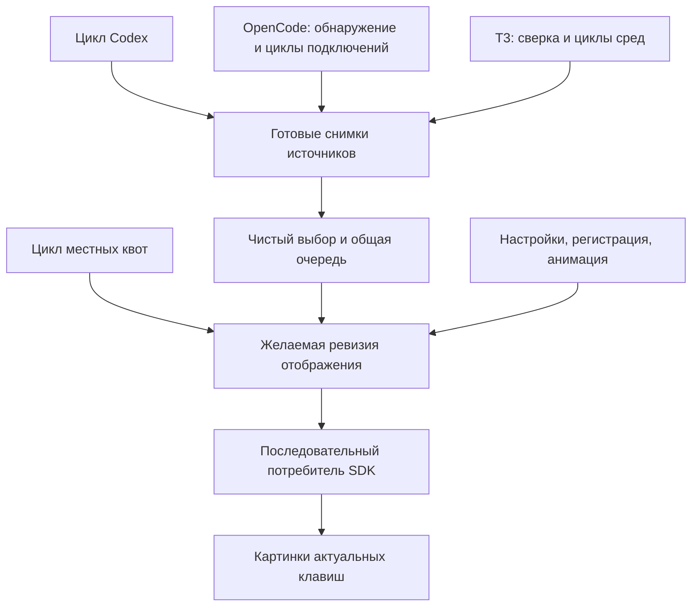
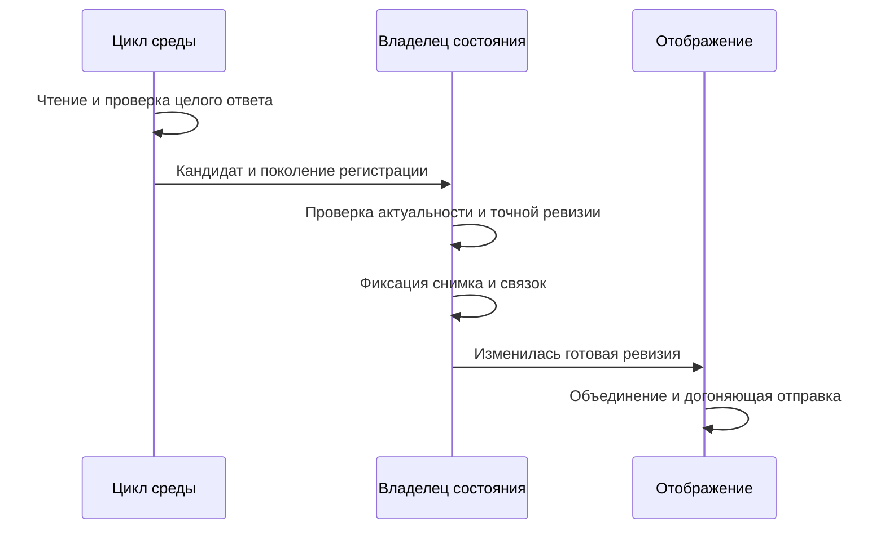
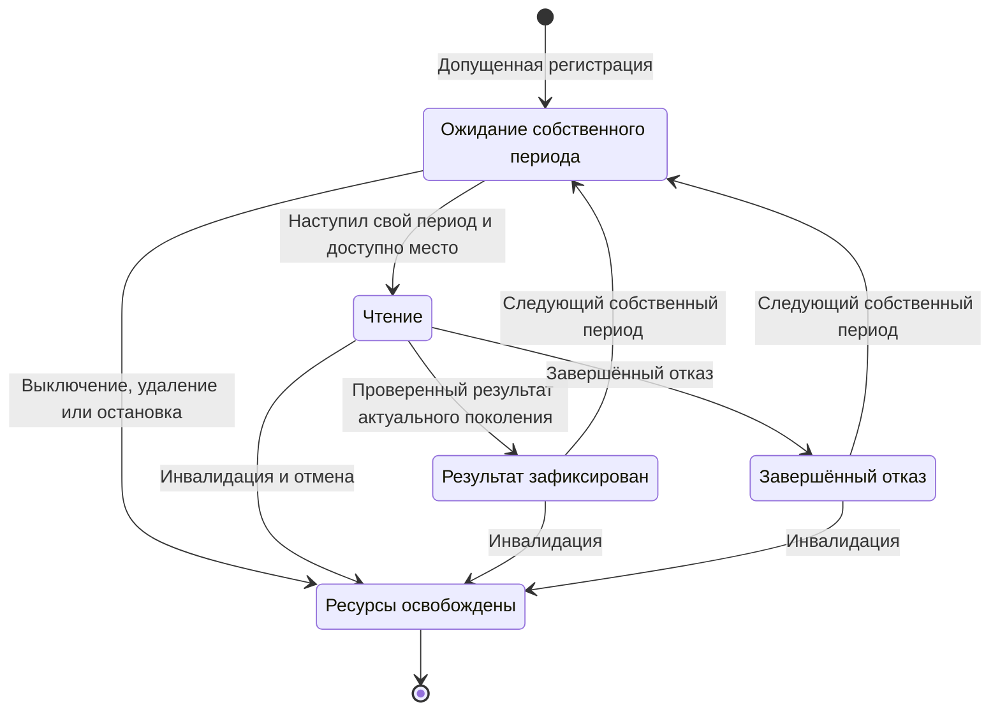
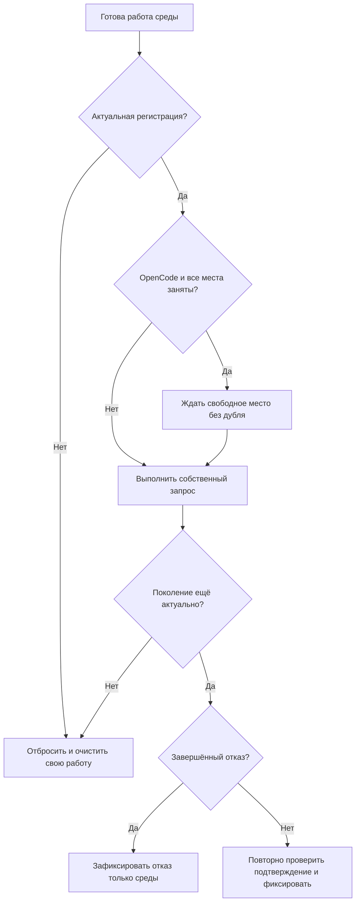

# Независимое обновление задач на клавишах - Plan

## Goal Capsule

- **Цель:** готовые местные изменения задач появляются на клавишах, пока медленное удалённое подключение ещё отвечает; следующие местные изменения также продолжают появляться.
- **Средство:** независимые циклы источников и сред, отдельная фиксация их результатов и объединённая доставка изображений (KTD1–KTD6).
- **Полномочия:** пользователь выбрал вариант «а» — реализовать независимые циклы из исходного предложения. Разрешены местная реализация, изолированные замеры, полная проверка, упрощение, исправление замечаний ревью и коммит непосредственно в `main`. Исторические предложение, аудит и план упаковки остаются самостоятельными записями.
- **Профиль исполнения:** один процесс, прежние источники и действия; без новых служб, платных ресурсов, настоящей удалённой нагрузки, профилирования сервисов, чтения личных баз или обхода отказа инструмента в доступе к Codex.
- **Условия остановки:** несовместимость принятой архитектуры с R1–R12 либо недоказанный выигрыш требуют отчёта и отмены соответствующего изменения с записью попытки; успешные промежуточные замеры не заменяют окончательные.
- **Завершение:** владелец основной сессии принимает итоговые свидетельства и делает коммит. Публикация, push и выпуск новой версии в эту работу не входят.

---

## Product Contract

### Summary

Обновление готовой среды сразу становится доступно общей очереди и отображению. Каждый источник продолжает своё расписание, пока другой ждёт сеть. Допуск местной работы OpenCode сохраняет общую ёмкость, а потребитель SDK объединяет накопившиеся изменения до последнего изображения.

### Problem Frame

Пользователь может ждать местную карточку из-за удалённой работы, которая не нужна для этой карточки. В исходном коде общее ожидание возникает при первоначальном запуске OpenCode, общей публикации OpenCode/T3 и следующем цикле контроллера. Ранняя публикация без независимого следующего опроса устраняет лишь часть задержки. Величина задержки настоящей сети пока не установлена.

### Requirements

**Независимость и данные**

- R1. Первоначальный запуск, публикация готового снимка и следующий местный цикл не ждут полного удалённого круга; общий предел допуска OpenCode остаётся отдельным ограничением исполнения по KTD3.
- R2. Codex, местные квоты, местный OpenCode и каждое допущенное подключение OpenCode/T3 получают независимую неперекрывающуюся работу с прежними периодами и защитными ожиданиями.
- R3. Одна среда публикует целый проверенный снимок со своим временем наблюдения; ожидание сохраняет прежний снимок, успешный пустой ответ очищает только эту среду, отказ T3 очищает только её прежние карточки.
- R4. Результат прежнего поколения источника или заменённой/удалённой регистрации не меняет снимки, метки, подтверждения, соединения, таймеры либо отображение.
- R5. Подтверждение точной завершённой ревизии повторно проверяется непосредственно при фиксации; прежняя ревизия не возвращается, новая завершённая ревизия может появиться снова.

**Отображение и взаимодействие**

- R6. Отправки SDK проходят через один последовательный потребитель, который догоняет последнюю ревизию без нового события источника; после снятия регистрации новые отправки её экземпляру не начинаются.
- R7. Удерживаемая клавиша отпускает назначение, захваченное при нажатии; общая очередь сохраняет точную идентичность, приоритеты, сроки завершений и ранги неизвестного начала.
- R8. Прежние режимы `Codex`, `OpenCode`, `T3 Code`, `All`, Mac и автономный Windows сохраняются; состояние источника остаётся агрегированным по KTD5.

**Границы и приёмка**

- R9. Лимиты допуска, параллелизма, размера, глубины, времени, проверки личности и закрытости данных не увеличиваются; правила `SECURITY.md` и областей из `docs/ARCHITECTURE.md` обязательны.
- R10. Остановка, выключение источника, переключение режима, изменение конфигурации и исчезновение среды освобождают принадлежащие им работы и ресурсы без воздействия на новое поколение.
- R11. Причинный местный сценарий проходит R1–R7 и окончательное сравнение по KTD7; каждый сохранённый выигрыш подтверждается окончательными числами либо изменение отменяется с записью в журнале.
- R12. Полный автоматический контракт `CONTRIBUTING.md` проходит в изолированной публичной копии; автоматические, прикладные и физические свидетельства сообщаются отдельно.

### Acceptance Examples

- AE1. **Covers R1–R3.** Удерживается наблюдаемый удалённый запрос при холодном запуске; три последовательных местных изменения доходят до подставного SDK до открытия сигнала. Этот же результат воспроизводится отдельно для публикации и следующего опроса.
- AE2. **Covers R4–R5, R10.** Во время запроса подтверждается текущая завершённая карточка или заменяется регистрация. Старый ответ ничего не возвращает; следующая действительная завершённая ревизия показывается.
- AE3. **Covers R6–R7.** SDK задерживает отправку, очередь меняется и клавиша удерживается. После освобождения SDK приходит конечное изображение, а отпускание направляется исходной задаче.

### Scope Boundaries

В объёме работы — три барьера исходного предложения, условный местный резерв OpenCode, раздельная публикация и доставка SDK. Изменение первого наблюдения задачи с неизвестным началом и вытеснение поздней удалённой карточкой по прежнему приоритету допустимы.

Не входят новые процессы, службы, интерфейс диагностики сред, изменения приоритетов карточек, длительности хранения подтверждений, индекса истории, горячих клавиш или чтения базы задач. Не вводится универсальная система расписания: существующие владельцы уже определены, её дополнительные расширения не нужны нынешнему контракту. Не строятся вытеснение выполняющегося удалённого сбора и постоянное резервирование пустого места: исходное предложение разрешает свободному месту обслуживать удалённую работу (KTD3).

### Deferred to Follow-Up Work

Настоящая сетевая нагрузка, длительные сеансы, Windows, повторная физическая проверка MK.2 и новая диагностика каждой среды требуют самостоятельных свидетельств или объёма работы. Прежняя физическая приёмка установленной упаковки не доказывает эту новую архитектуру.

---

## Planning Contract

### Key Technical Decisions

- KTD1. **Независимость остаётся у нынешних владельцев.** Контроллер ведёт раздельные циклы Codex и квот; OpenCode владеет обнаружением, допуском, подключениями и их циклами; T3 владеет сверкой конфигурации и циклами сред. Общая очередь получает только готовые данные по R1–R3. (session-settled: user-directed — chosen over unchanged polling and two local/remote groups: пользователь выбрал независимое обновление каждой среды с указанной ценой сложности и местного резерва.) Новая абстракция расписания и новый процесс не нужны; альтернативы уже сравнены в исходном предложении.
- KTD2. **Начало работы отделено от первого полного снимка.** `start`/`syncDemand` подготавливают владельца и начинают работу; готовые результаты приходят отдельными уведомлениями. Контроллер не ждёт первых SSH-ответов перед местными циклами. Рабочие публичные подписки источников возвращают отписку и сообщают только о зафиксированных данных/состоянии; подключение и секреты не пересекают `#opencode`/`#t3code`.
- KTD3. **Общий допуск OpenCode ограничен и не вытесняет запросы.** Сохраняются максимум 3 сбора и 2 SSH-обнаружения во всём коллекторе. Если местная работа действительно ожидает и местный резерв ещё не занят, одно следующее свободное место предоставляется ей. Остальная ёмкость обслуживает общую ограниченную FIFO-очередь, поэтому постоянное местное ожидание не лишает удалённые подключения исполнения. При отсутствии местного ожидания удалённые сборы могут занимать все 3 места. FIFO и не более одной ожидающей/исполняемой работы на подключение предотвращают накопление дублей. Уже начатые удалённые работы не отменяются: если все 3 заимствованных места заняты, позднее местное ожидание ждёт первое освобождение. Это ограничение ёмкости, а не общий барьер запуска/публикации; причинный сценарий AE1 должен иметь доступное место, а насыщенный случай измеряется отдельно. При конкуренции цена для удалённого круга показывается явно. Трактовка резерва как одного места задана владельцем основной сессии по принятому предложению; дополнительный возрастной порог или обещание общего ожидания не более 5000 мс не вводятся.
- KTD4. **Фиксация принадлежит экземпляру среды.** Подготовка кандидата не меняет общие связки. Синхронная фиксация проверяет поколение источника и регистрации, затем актуальное подтверждение точной ревизии, и лишь после этого меняет снимок, метки и состояние подтверждений (R4–R5). Старую проекцию нельзя повторно прогонять через мутирующий `OpenCodeTaskState.project`, заменяя более новую связку. Каждый владелец очищает только свой promise в `finally`; старая остановка не очищает новые циклы.
- KTD5. **Сверка состава и состояние сохраняют прежнюю семантику.** OpenCode собирает первые 17 допустимых подключений из местных и SSH, сохраняя сортировку и предпочтение местных регистраций; SSH-настройки допускают до 16. Это не правило «1 местная + 16 удалённых»: допускаются 17 местных регистраций. Существующие пустые диагностики неудавшегося SSH-обнаружения могут добавляться после среза 17, а само обнаружение уже происходит до среза; не изображать 17 как общий предел всех диагностических записей или всех работ обнаружения. T3 допускает местную среду и до 8 SSH; ему не переносится cap3 OpenCode. Авторитетное удаление/изменение снимает только соответствующую среду; ошибка чтения SSH-настроек OpenCode не доказывает удаление туннелей. Небезопасная локальная регистрация остаётся отсутствующей. Ошибка общей приватной конфигурации T3 отменяет все её среды и очищает данные как раньше. OpenCode готов при хотя бы одном `ready`/`capacity-exceeded`; T3 деградирует при любом завершённом отказе, остаётся `connecting` при ещё не завершённых первых проверках без известного отказа и становится `ready`, когда необходимые первые результаты получены. Готовые карточки публикуются и в промежуточном состоянии; ожидание не обновляет `observedAt`/`changedAt` старой среды.
- KTD6. **Данные и отправки разделены.** Все пути отображения — источник, настройки, регистрация, квоты, подтверждение, анимация — обновляют желаемую ревизию у одного потребителя. Он сериализует проходы отправки, объединяет промежуточные ревизии и обязательно повторяет проход при накопившемся изменении. Проверяет поколение контроллера и экземпляр регистрации перед каждым новым вызовом SDK; уже начатый вызов может завершиться, но не меняет кеш новой регистрации. Неудачная отправка не считается доставленной, освобождает потребителя и не создаёт тесный бесконечный повтор; накопившаяся новая ревизия продолжается, прежняя повторяется на следующем обычном событии. Сохранённая пара нажатия/отпускания остаётся отдельной последовательностью (R6–R7).
- KTD7. **Причина, скорость и цена проверяются раздельно.** До правки выполняются минимум 3 исходных прогона. После упрощения и ревью выполняются 5 чередующихся пар исходной и окончательной версии с одинаковыми данными и настройками сборки из методики. Для заявленного ускорения выигрыш превышает max(10%, (max−min)/median исходной серии), и каждый результат после лучше каждого до. Пороги предполагаемые (`assumed`), фиксируются до изменений. Длительности и условия освобождения подставной удалённой работы фиксируются до исходных серий и одинаковы в обеих версиях: T3 — 3500 мс при прежнем guard 4000 мс; OpenCode — три последовательных этапа по 4500 мс, каждый с прежним guard 5000 мс, всего 13500 мс синтетического круга. Эти параметры — `assumed`; фактически полученные интервалы сохраняются, а несоблюдение этапов означает отказ сценария, не подбор новых чисел. Для трёх собственных OpenCode-циклов сохраняется период 5000 мс: один HTTP-запрос длительностью 5000 мс не используется как доказательство трёх таких циклов. Логическая проверка порядка и численное сравнение по реальным часам разделены; guards должны действовать и в фикстуре. Длительность полного занятия места не выводится из таймаута одного запроса и заранее не объявляется доказанным сетевым максимумом. Отсутствие ожидания доказывается порядком событий при удерживаемом запросе, время измеряется реальными часами отдельно; синтезированное ожидание не выдаётся за настоящую сеть. Правило числа запросов ≤+10% применяется к здоровой неизменной нагрузке при одинаковой возможности выполнения циклов. При удерживаемом удалённом запросе дополнительные местные опросы являются ценой разрешённого прогресса и измеряются отдельно, без универсального ограничения +10% на этот случай.

### Assumptions

- Периоды сохраняются: 1200 мс для нынешних опросов контроллера/T3, 5000 мс OpenCode, 200 мс анимации; внутри независимого владельца новый цикл не перекрывает предыдущий. Защитные таймауты 4000/5000 мс и отдельные ограничения аутентификации/парного подключения сохраняются.
- Защитные бюджеты (`assumed`): средняя/пиковая память процесса ≤ max(10%, 16 МиБ) прироста; CPU здорового одинакового сценария ≤ max(10%, 5 мс) прироста процессорного времени; фактическая полная сборка ≤ max(10%, 10 мс); публичные операции без ожидания сети ≤ max(10%, 1 мс); размеры каждого прежнего готового пакета ≤+10%. Неполное измерение пика дерева процессов явно отмечается, показание отдельной команды его не заменяет.
- Не более 1800 секунд действительных местных прогонов; минимум 600 секунд остаётся окончательным замерам и полной проверке. Отдельный журнал временных интервалов команд считает фактическую работу без двойного счёта; время размышлений и ожидания ревью не считается прогоном.
- Оценка усилия исходного предложения 1–3 рабочих дня остаётся предположением; длительность общения с моделью не является этой оценкой.

### High-Level Technical Design

Компоненты и поток готовых данных:

Порядок безопасной публикации:

Жизненный цикл экземпляра среды:

Решения при допуске и завершении:

### System-Wide Impact

В `All` результаты разных сред становятся видны в разное время, поэтому неизвестное начало впервые ранжируется раньше либо позже, чем в прежнем полном круге. Приоритет и точная идентичность остаются правилами `#agents`. Условный резерв снижает доступные удалённым сборам места при местном ожидании и не гарантирует мгновенный допуск при уже занятой ёмкости. SDK остаётся общим конечным устройством; его задержка может задержать картинки, но больше не должна задерживать опросы.

### Sequencing

U1 предшествует архитектурным правкам. U2 и U3 владеют только собственными областями и тестами; общий `test/source-isolation.test.ts` принадлежит U1 для исходной характеристики и U4 для последовательной интеграции. Подписки передают уведомление без данных и возвращают отписку по KTD2. U5 затем U4 выполняет один владелец контроллера без параллельных правок этого файла; U4 отдаёт ревизии уже готовому потребителю U5. Все действительные замеры выполняет один исполнитель последовательно, независимо от возможности параллельных правок областей. U6 принимает интегрированный кандидат целиком.

### Sources / Research

Основание — `docs/plans/2026-10-14-local-source-isolation-proposal.md` и новый выбор пользователя «а». Прежняя фраза предложения об отсутствии разрешения историческая и не ограничивает выбранную теперь реализацию. Настоящая сеть остаётся неизмеренной.

Первичная трасса: `src/stream-deck/controller.ts` (`start`, `refreshOnce`, `scheduleRefresh`, `setImage`, `sendAgent`), `src/opencode/source.ts` (`syncDemand`), `src/opencode/collector.ts` (`start`, `collect`, `discoverSsh`), `src/opencode/state.ts` (`project`, `acknowledgeTask`), `src/t3code/source.ts` (`refresh`, `taskSlot`, `open`), `src/codex/source.ts` (`refresh`, `stop`). Локальные образцы уже включают независимое расписание OpenCode, анимацию, текущую работу и поколенческие проверки; внешняя замена библиотеки или протокола не требуется. `PRODUCT.md` подтверждает физические клавиши, прежние платформенные различия и отсутствие облачного сервиса.

---

## Implementation Units

### U1. Причинная исходная нагрузка и характеристика

**Цель:** воспроизвести три барьера до изменения архитектуры и зафиксировать исходные серии.

**Требования:** R1, R9, R11–R12; KTD1, KTD7. **Зависимости:** нет.

**Файлы:** `test/controller.test.ts`, `test/opencode-collector.test.ts`, `test/t3code-source.test.ts`, при необходимости отдельный `test/source-isolation.test.ts`; измерительный сценарий и сырые результаты — в системном временном каталоге, не в поставке.

**Подход:** характеризовать публичные методы настоящего коллектора/источника/контроллера с временными защищёнными регистрациями, подставным HTTP/SSH и `KeyAction`. Ближайшие образцы — существующие зависимости OpenCode и управляемые часы контроллера. Неизменённый исходный T3 проходит настоящий `t3SshRequest` с подставным `node:child_process` ниже существующего SSH-адаптера; образцы подстановки встроенных модулей и динамического импорта есть в `test/macos-launcher.test.ts` и `test/controller.test.ts`. Подставной процесс сохраняет stdin/stdout, отмену и ограничение ответа настоящего адаптера и не запускает SSH. Существующие зависимости OpenCode подменяют файлы, HTTP и процессы. Новая производственная точка внедрения не требуется для исходных серий и не подмешивается в базовый код. Если нижняя подстановка не достигает нужной границы, U1 сообщает конкретный отказ сценария до архитектурных правок; изменённый код не называется исходным.

**Направление исполнения:** сначала сохранить исходный код, данные, события и минимум три серии; проверка порядка событий отдельно от времени. Новая проверка требуемой независимости должна показывать исходный барьер, а не «проходить» прежнюю схему ослаблением результата.

**Сценарии проверки:**

1. Covers AE1. Холодный старт: наблюдаемый удалённый сигнал принят, три местных изменения приготовлены последовательно; исходный код удерживает соответствующие публикации до освобождения.
2. Covers AE1. Уже работающий коллектор/T3: готовый ответ одной среды ждёт другой в исходной версии.
3. Covers AE1. Уже показанная первая карточка: удержанный следующий удалённый круг задерживает очередные местные изменения в исходной версии.
4. Здоровые неизменные данные: сохранить число запросов и пробуждений, периоды, счётчики параллелизма, CPU/память и количество SDK-вызовов; отдельная нагрузка включает 17 местных регистраций и смесь с 16 OpenCode/8 T3 SSH.

**Готовность:** воспроизводимый сценарий проходит публичную цепочку до изображений и различает каждый барьер; исходные результаты и пороги зафиксированы до правки.

### U2. Независимые среды OpenCode и условный допуск

**Цель:** местное обнаружение, сбор и публикация продолжаются независимо от удалённого круга.

**Требования:** R1–R5, R9–R10; KTD1–KTD5. **Зависимости:** U1.

**Файлы:** `src/opencode/collector.ts`, `src/opencode/source.ts`, `src/opencode/state.ts`, `src/opencode/contracts.ts`, `src/opencode/index.ts`, при необходимости `src/opencode/collection-utils.ts`; `test/opencode-collector.test.ts`.

**Подход:**

1. Разделить авторитетное обнаружение местных регистраций и сохранённых SSH; неизменные записи сохраняют экземпляр цикла, замена инвалидирует старый до публикации.
2. Применить общий ограниченный допуск KTD3 к собственным циклам; SSH-обнаружение сохраняет отдельный общий предел 2 и прежнюю очистку orphan-туннелей.
3. Фиксировать и уведомлять по одной среде по KTD4–KTD5; источник переводит готовые снимки через свою публичную подписку по KTD2.

**Образцы:** нынешняя проверка descriptor/identity, повторное использование соединения, отмена клиента, двойная очистка поздних детей при `stop` и ограниченные ancestor-запросы остаются у OpenCode.

**Сценарии проверки:**

1. Covers AE1. Удержанное SSH-обнаружение и затем удалённый сбор не мешают трём местным снимкам и собственным следующим циклам при доступном месте.
2. 17 местных регистраций без SSH и смешанный набор сохраняют прежний допуск/порядок; диагностические неудачные SSH после среза не теряются.
3. Три выполняющиеся удалённые работы: появившееся местное ожидание не отменяет их, но получает первое свободное место; при отсутствии местного ожидания все три места доступны удалённым работам.
4. Смешанные 16 местных и 1 удалённое подключение при постоянном местном ожидании продвигаются через один местный резерв и остальные FIFO-места; повторно встающая местная работа не обгоняет уже ожидающую удалённую. Несколько местных ожиданий не голодают; счётчики во всех поколениях не превышают 3 сборов/2 обнаружений, повторные тики не копят работы.
5. Covers AE2. Подтверждение после подготовки кандидата до фиксации не возвращает ревизию и не откатывает более новую terminal-связку; новое завершение появляется.
6. Остановка во время секрета, обнаружения, запроса, ожидания допуска и позднего создания процесса очищает ресурсы; быстрый повторный запуск не получает таймеров/результатов прежнего поколения.
7. Авторитетное удаление/смена target/endpoint/password/version/pid затрагивает только свою регистрацию; нечитаемые SSH-настройки сохраняют прежнюю безопасную семантику.
8. Пустой успех, отказ и несовместимая личность одной среды сохраняют остальные; pending не меняет чужой `observedAt`, лимиты объёма/глубины и аутентификационные guards проходят прежние тесты.

**Готовность:** поведение подтверждено через публичные `start`/`refresh`/`snapshot`/`acknowledgeTask`/`stop` и подписку; нет общего in-flight барьера для всех сред.

### U3. Независимые циклы и фиксация T3

**Цель:** местный T3 и каждая удалённая среда публикуют и повторяют свою работу независимо.

**Требования:** R1–R5, R8–R10; KTD1–KTD2, KTD4–KTD5. **Зависимости:** U1; публичная форма уведомления согласуется с U2, без зависимости T3 от OpenCode.

**Файлы:** `src/t3code/source.ts`, `src/t3code/index.ts`, при необходимости `src/t3code/ssh.ts`; `test/t3code-source.test.ts`.

**Подход:** источник сверяет защищённую конфигурацию независимо от pending SSH и ведёт записи сред по нынешнему namespace/идентичности. Для новых циклов сохраняется нижняя подстановка процессов из U1. Если рабочая зависимость потребуется реализации, она остаётся внутри области и не позволяет настройкам или композиции отключать проверку личности/аутентификации/размера; ни один готовый снимок не фиксируется раньше этих проверок. Собственные таймеры присоединяют текущую работу одной среды; вызов обновления местного источника не отменяет удалённую работу. Фиксация и состояние подчинены KTD4–KTD5.

**Сценарии проверки:**

1. Covers AE1. Медленный допустимый SSH-запрос удерживается, три последовательных местных изображения подготовлены, остальные среды продолжают опрос; сигнал удалённой отмены не возникает от местных тиков.
2. Отказ ранее успешной среды очищает только её старые карточки, пустой успех очищает только её, pending сохраняет время прежнего снимка; ready/connecting/degraded отвечают KTD5.
3. Covers AE2. Подтверждение между подготовкой и фиксацией отсекает точную ревизию с namespace среды; следующая завершённая ревизия показывается.
4. Выключение/включение, смена токена/host/environmentId, удаление среды и stop/start при pending отменяют прежнее поколение, снимают его карточки и не стирают новую работу.
5. Ошибка общей конфигурации очищает источник и отменяет известные работы; 8 SSH допускаются, девятое и дубликаты отвергаются по прежней семантике, временные и ответные пределы сохраняются.

**Готовность:** управляемая SSH-фикстура доказывает независимый следующий цикл через публичные `syncDemand`/`refresh`/`open`/`stop` и уведомления.

### U5. Последовательная доставка конечной картинки

**Цель:** накопленные обновления достигают актуальных клавиш без устаревшего кеша или перенаправления отпускания.

**Требования:** R6–R7, R10; KTD6. **Зависимости:** U1.

**Файлы:** `src/stream-deck/controller.ts`, `test/controller.test.ts`.

**Подход:** все пути рендера проходят потребителя KTD6, сохраняя подавление одинаковых картинок и корректную очистку заголовка. Перепроекция очереди не переписывает сохранённый `AgentPress`.

**Сценарии проверки:**

1. Covers AE3. SDK задерживает первую отправку; две новые ревизии объединяются, последняя обязательно приходит после освобождения без нового тика источника.
2. Отказ `setImage`/`setTitle` не оставляет потребителя занятым и не отмечает неотправленную ревизию доставленной; следующая обычная ревизия восстанавливает экран без тесного повтора.
3. Снятие регистрации во время медленного чтения картинки/заголовка запрещает дальнейшие вызовы старому экземпляру; возврат того же id не наследует его кеш, stop/start не получает старую отправку.
4. Covers AE3. Удержанная задача вытеснена поздней удалённой карточкой: отпускание направляется исходной точной задаче; пустая клавиша остаётся no-op, контексты разных клавиш независимы.
5. Источник, настройка и анимация меняются при SDK pending: последовательность отправок не откатывает конечную картинку, неизменные картинки не отправляются повторно.

**Готовность:** подставный SDK наблюдает финальную ревизию и сохранённую пару ввода; физическая скорость экрана из этих тестов не выводится.

### U4. Раздельный опрос контроллера и безопасный запуск

**Цель:** ни старт OpenCode, ни квоты/T3, ни отправки SDK не держат следующий опрос Codex.

**Требования:** R1–R2, R4, R8, R10; KTD1–KTD2, KTD6. **Зависимости:** U2, U3, U5.

**Файлы:** `src/stream-deck/controller.ts`, `src/codex/source.ts`, `src/plugin.ts` только если требуется композиция; `test/controller.test.ts`, `test/source-isolation.test.ts`.

**Подход:** контроллер подписывается на готовые источники и ведёт отдельные периоды Codex/квот, не ожидающие SDK или T3. Поколение проверяется после каждого ожидания запуска, а Codex не фиксирует ответ закрытого поколения. Прежнее присоединение перекрывающихся запросов Codex при отпускании сохраняется для одного владельца. Новые методы областей доступны через существующие публичные `#area` с обычными ESM-импортами.

**Сценарии проверки:**

1. Covers AE1. Подставные квоты, T3 и OpenCode поочерёдно удерживаются: холодный старт и три следующих Codex-изменения доходят до потребителя независимо.
2. Stop до возврата настроек, до `codex.start`, во время source-start/refresh; поздний ответ не назначает таймер, не меняет state и не отправляет картинку. Повторный start работает в новом поколении.
3. Режимы источника и active queue переключаются при pending: снимок выключенного источника не возвращается, циклы востребованных владельцев сохраняются, источник включается однократно.
4. Нажатие не добавляет опрос, отпускание присоединяется уже выполняющемуся Codex-опросу, следующий период запускает ровно одну работу; анимация не опрашивает источники.
5. Windows сохраняет renderer-квоты и прежние локальные действия; Mac использует прежние местные квоты без запуска или прикрепления приложения ради чтения.

**Готовность:** публичные методы и управляемые часы подтверждают независимые периоды опроса без сокращения защитных условий.

### U6. Окончательное сравнение, документация и проверка

**Цель:** сохранить только доказанный результат и полный проверяемый комплект свидетельств.

**Требования:** R8–R12; KTD7. **Зависимости:** U2–U5; окончательные числа собираются после упрощения и устранения замечаний ревью.

**Файлы:** `docs/ARCHITECTURE.md`, `docs/OPENCODE_COMPATIBILITY.md`, `docs/T3CODE_COMPATIBILITY.md`, раздел совместимости Codex в `docs/ARCHITECTURE.md` при изменении renderer-интеграции; `docs/maintenance/performance/journal.md`, при необходимости `docs/maintenance/performance/README.md`; проверяемые тесты предыдущих единиц.

**Подход:** измерить финальный код против сохранённого исходного снимка по KTD7 и бюджетам предположений. Отдельно показать цену резерва удалённому кругу, насыщение 3 заимствованных мест и дополнительные местные запросы, пробуждения и CPU за одинаковое фиксированное окно при удержанной удалённой работе. Документы описывают новые владельцы, частичные результаты и фактические границы проверенного. Не менять исторические артефакты.

**Сценарии проверки:**

1. Пять чередующихся пар повторяют cold-start/publication/next-poll, три местных изменения и последнюю отправку; порядок событий и времена сохраняются в сырых данных без скрытых повторов/выбросов.
2. Здоровые неизменные данные проходят запросный/CPU/памятный бюджет; 17 местных и смешанная максимальная конфигурация не превышают прежних лимитов и не копят работы.
3. Выполняется весь контракт Verification Contract, включая упаковку и аудит полного набора; прежние выигрыши компактной карты/минификации/обложки не отменены.
4. У каждого отклонённого изменения есть отмена и запись причины; у каждого оставленного — итоговые исходные/окончательные числа и независимая проверка арифметики.

**Готовность:** Definition of Done выполнен: окончательные замеры, полная автоматика, упаковка, аудит и независимое ревью завершены. Недоступные прикладные, платформенные и физические проверки явно перечислены отдельно и не заменяют обязательные проверки.

---

## Verification Contract

Проверки идут в отдельной публичной копии с настоящими зависимостями; рабочий `dist` связан с установленным плагином, а сборки удаляют его содержимое, включая живые журналы. Нельзя выполнять сборку/тестовый комплект из рабочего корня или создавать ссылку из копии в его `dist`.

| Проверка | Применение | Свидетельство завершения |
|---|---|---|
| Исходный причинный сценарий | U1 | ≥3 исходных прогона, сохранённые пороги, gate/counters/events через публичные методы |
| Поведение и жизненный цикл | U2–U5 | Управляемые логические часы и наблюдаемые маркеры; три местных изменения до release удалённого gate в каждом из трёх сценариев |
| Установка и полная автоматика | U6 | `npm ci`, `npm run lint`, `npm run check:boundaries`, `npm run check`, `npm test`, `npm run validate` — все успешны в копии |
| Полные готовые артефакты | U6 | `npm run pack`, затем `npm run audit:release`; дополнительные созданные ZIP явно включены в аудит |
| Финальная производительность | U6 | 5 чередующихся пар окончательного кода по KTD7, отдельные wall/CPU/память/запросы/допуск/размеры и цена резерва |
| Независимая проверка | U6 | Упрощение, полное ревью кода, все принятые замечания исправлены; правки после замера повторно измерены |
| Живое приложение | Отдельное свидетельство | Если проверка доступна — точная кандидатная сборка, поколение процесса и наблюдаемые карточки; иначе честное `не проверено`/`DEGRADED` |
| Физическое устройство | Отдельное свидетельство | Новая архитектура не считается проверенной по прежней приёмке MK.2; без нового опыта — `не проверено` |

Живой переход допустим лишь при доказанно изолированном кандидате и обратимой точечной замене публичных файлов того же fork с сохранённым возвратом; им владеет основная сессия. Нативное окно Codex уже запрещено инструментом «for safety reasons»: обход не допускается. Нет запуска настоящего SSH/Fedora, платного облака или CI через push. Автоматическое создание архивов на Mac не доказывает Windows.

---

## Definition of Done

| Область | Требование готовности |
|---|---|
| U1 | Исходное общее ожидание воспроизводимо по публичной цепочке, до правки получены серии и объявлены бюджеты |
| U2 | Независимые среды OpenCode, условный резерв, фактический допуск и отмена проходят публичные сценарии |
| U3 | Независимые T3-среды не отменяются местными тиками, сохраняют точные подтверждения и семантику ошибки |
| U4 | Холодный запуск и следующие местные циклы свободны от общего удалённого ожидания, поколения и режимы корректны |
| U5 | SDK получает конечную картинку, снятые регистрации не получают новых вызовов, отпускание использует исходное назначение |
| U6 | Финальные пары/бюджеты, полная автоматика, упаковка/аудит и независимое ревью завершены; журнал содержит оставленные и отменённые попытки |
| Сохранность | Отсутствуют личные данные, производственные логи, токены, проприетарные ресурсы и готовые bundles в коммите; чужие изменения сохранены |
| Отчёт | Автоматика, живое приложение, физическое устройство, Windows и настоящая сеть перечислены раздельно с фактическими ограничениями |

Временные копии, зависимости и готовые архивы удаляются только в пределах разрешённой уборки. Сырые измерения, сценарий повторения, хэши и квитанции остаются для проверки; их размер и место сообщаются владельцу. После принятия результат фиксируется непосредственно в `main` без ветки, публикации и выпуска.
